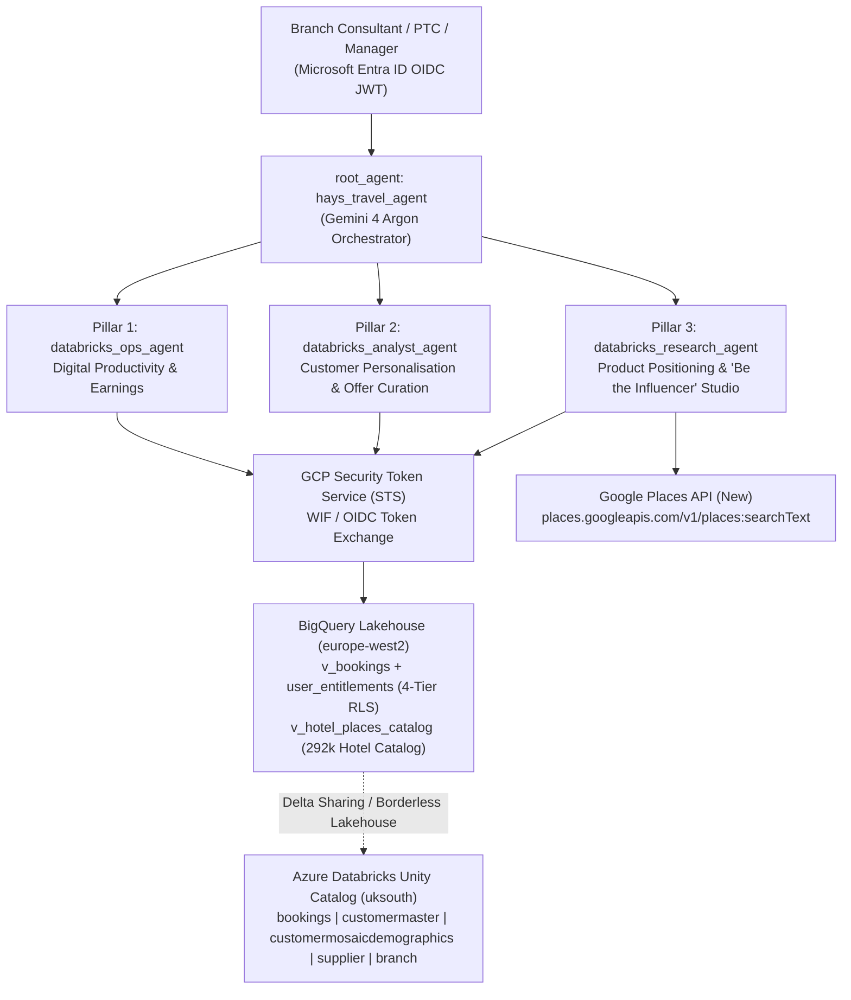

# Hays Travel Personal Assistant — Multi-Agent System on Google Cloud ADK

**Marrying Emotional Intelligence with Artificial Intelligence** for 5,000+ Hays Travel retail branch colleagues and Personal Travel Consultants (PTCs).

Built with the **Google Agent Development Kit (ADK)**, **Vertex AI (`gemini-4-argon`)**, and **Google Cloud BigQuery (`europe-west2`)** with native **Workload/Workforce Identity Federation (WIF) + OIDC 4-Tier Row-Level Security (RLS)** and **Azure Databricks Delta Sharing / Borderless Lakehouse** coexistence.

---

## 1. Architecture Overview



### Core Architectural Principles
1. **Single Unified Orchestrator (`hays_travel_agent`) + 3 Domain Sub-Agents:**
   - Deployed in EMEA (`europe-west2`) with `gemini-4-argon` on the Vertex AI global endpoint (`GOOGLE_CLOUD_LOCATION=global`).
2. **Pure WIF / OIDC End-to-End Identity Propagation (No Service Account Keys):**
   - The caller's Microsoft Entra ID OIDC token is exchanged via GCP Security Token Service (`sts.googleapis.com/v1/token`).
   - BigQuery evaluates `SESSION_USER()` directly against `user_entitlements` inside the `v_bookings` RLS view across all 4 organizational tiers:
     - **Tier 1 (`BRANCH_STAFF`):** `SaleBranchID = branch_id AND Username = username`
     - **Tier 2 (`BRANCH_MANAGER`):** `SaleBranchID = branch_id`
     - **Tier 3 (`REGIONAL_MANAGER`):** `SellingBranch.BranchGroup = region_group`
     - **Tier 4 (`DIVISIONAL_HEAD`):** `SellingBranch.BranchBusinessDivision = division` (or `'ALL'`)
3. **Coexistence with Azure Databricks Lakehouse:**
   - Supports both direct Cross-Cloud Borderless Lakehouse federation (via Unity Catalog Iceberg REST / UniForm + BigQuery `v_bookings` RLS view; see [`azure_databricks_borderless_lakehouse_guide.md`](../azure_databricks_borderless_lakehouse_guide.md)) and automated Delta Sharing hydration (`sync_delta_share_to_bq.py`).

---

## 2. Sub-Agents & Tool Reference

### Pillar 1: Digital Productivity & Earnings Assistant (`databricks_ops_agent`)
Removes morning and Monday administrative toil for retail branch consultants, PTCs, and branch managers.
- **`get_monday_morning_weekly_plan(reference_date, tool_context)`**
  - Generates a unified Monday morning action plan ("Day in the Life of a Branch Agent") combining the 1WD daily + pay-period MTD earnings summary, priority T+7 Welcome-Home calls, and urgent 14-day balance collection reminders (prioritizing bookings with `IsActiveDirectDebit = 'N'`).
- **`get_morning_sales_briefing(booking_date, tool_context)`**
  - Replicates the **1WD Agent Report** SQL metrics (bookings count, total passengers, gross sales, profit, and commission earned) for both the single day (`summary_1wd`) and the active **monthly commission pay period (8th of month $\rightarrow$ 7th payday cut-off)** (`pay_period_mtd_summary`).
- **`get_welcome_home_call_list(return_date, tool_context, lookback_days=7)`**
  - Retrieves customers returning within a rolling **T+7 window** (`return_date - 7 days` to `return_date`), filtered by probabilistic identity resolution (`customermaster.confidence_score >= 425`) and enriched with Experian Mosaic demographics (`MosaicGroup`, `MosaicType`).
- **`get_balance_due_tracker(due_before_date, tool_context)`**
  - Tracks active bookings (`Cancelled = 'N'`) with `Outstanding > 0` due on or before `due_before_date`.

### Pillar 2: Customer Personalisation & Tailored Offer Curation (`databricks_analyst_agent`)
Reclaims ~60% of marketing time spent manually copying supplier deals and shifts consultants from blanket mailers to tailored, high-margin recommendations.
- **`curate_tailored_offers_and_wildcards(branch_id, tool_context, mosaic_group="ALL")`**
  - Answers *"Based on my customers' booking history, what offers should I pitch today?"* by returning:
    1. **Core Tailored Offers** matched to the branch's historical top sellers and Experian Mosaic segments, and
    2. **3 High-Margin Wildcard Categories** grounded 100% in `v_bookings` and `supplier`:
       - **Hays Vista In-House Wildcards (`HAYS_VISTA_WILDCARD`):** `SupplierID = 'VIS0001'` (`Hays Tour Operating Limited (Vista)`, 18–25% margin vs. 10–12% 3rd-party).
       - **Cruise Wildcards (`CRUISE_WILDCARD`):** Unnested from `CruiseDetails` (`VoyageName`, `ShipName`, `Traveltek_CreditorName`).
       - **Long-Haul Wildcards (`LONG_HAUL_WILDCARD`):** Filtered on `DestinationType.DestinationCategory = 'Long Haul'`.
- **`get_customer_360_and_ancillary_gaps(branch_id, tool_context)`**
  - Surfaces individual Customer 360 profiles (`confidence_score >= 425`), Experian Mosaic UK groups, and pre-departure ancillary cross-sell gaps:
    - **In-branch Foreign Exchange (`AllFXOrders`)** where the selling branch stocks Forex (`branch.HasForex = 'Yes'`),
    - **Holiday Extras Airport Parking / Lounge (`CarParkDetails`)**,
    - **Hays Travel Insurance (`InsuranceDetails`)**.
- **`query_lakehouse_sql(sql_query, tool_context)`**
  - Executes read-only GoogleSQL `SELECT` / `WITH` analytical queries against `v_bookings`, `v_hotel_places_catalog`, `customermaster`, `customermosaicdemographics`, `supplier`, and `branch`.

### Pillar 3: Product Positioning, Localisation & "Be the Influencer" Studio (`databricks_research_agent`)
Empowers branches and PTCs to identify trending regional packages, standardize uncleaned supplier hotel names, and generate CMA/ABTA-compliant promotional copy in under 60 seconds.
- **`get_top_regional_all_inclusive_deals(branch_or_city, nights, tool_context, booking_date="ALL")`**
  - Answers regional demand prompts (e.g., *"Show me the top 10 7-night all-inclusive offers sold from Glasgow or Newcastle"*), deduplicating multiple flight legs per booking, filtering specifically for All-Inclusive `BoardBasis`, attaching the canonical `LicensedImageLibraryId` (`HAYS-IMG-...`), and returning a regional tone-of-voice profile:
    - **North East England (`0015` Newcastle / `8912` Sunderland):** Warm, neighbourly North East charm (`Newcastle International NCL`).
    - **Scotland (`9024` / `9037` / `9038` Glasgow):** Friendly, upbeat Scottish warmth (`Glasgow Airport GLA`).
    - **North West England (`Manchester`):** Energetic, bold North West tone (`Manchester Airport MAN`).
- **`enrich_hotel_with_google_places(hotel_name, resort, destination, tool_context)`**
  - Resolves messy supplier `(HotelName, Resort)` strings across the 292,000 hotel/resort catalog using:
    1. BigQuery Golden Catalog View (`v_hotel_places_catalog`) for cross-supplier variant deduplication, standardized `Country -> Sector -> Resort -> Canonical Hotel` hierarchy, in-house Hays Vista (`VIS0001`) availability check, and verified `licensed_image_library_id`.
    2. Live **Google Places API (New)** (`places.googleapis.com/v1/places:searchText`) enrichment when `GOOGLE_PLACES_API_KEY` is configured (`google_place_id`, formatted address, lat/lng coordinates, verified Google rating, review count, and editorial summary).

---

## 3. Repository Structure

```text
.
├── azure_databricks_borderless_lakehouse_guide.md   # Customer runbook: Cross-Cloud Lakehouse + WIF/OIDC + RLS
├── azure_databricks_borderless_lakehouse_guide.pdf  # Shareable PDF edition of the Borderless Lakehouse guide
├── sync_delta_share_to_bq.py                        # Delta Sharing -> BigQuery hydration & physical-to-logical schema mapper
└── hays-travel-agent/                               # Google Cloud ADK Multi-Agent application
    ├── app/
    │   ├── agent.py                                 # Root orchestrator, 3 sub-agents, WIF/OIDC auth, & 9 BigQuery/Places tools
    │   ├── fast_api_app.py                          # FastAPI / Cloud Run A2A & ADK server entrypoint
    │   └── app_utils/                               # Telemetry, A2A protocol, and service helpers
    ├── tests/
    │   ├── unit/test_dummy.py                       # Live unit & BigQuery integration verification suite
    │   ├── integration/                             # Agent & FastAPI server integration tests
    │   └── eval/                                    # ADK evaluation config & response quality graders
    ├── agents-cli-manifest.yaml                     # agents-cli project manifest
    ├── Dockerfile                                   # Cloud Run production container definition
    ├── pyproject.toml                               # Python dependencies (managed via uv)
    └── README.md                                    # Detailed agent documentation
```

---

## 4. BigQuery Dataset Schema (`hays_travel_sharing` in `europe-west2`)

| Table / View | Rows | Description |
| :--- | ---: | :--- |
| `bookings` | 867,461 | Core transactions table with 72 top-level columns and 14 nested `STRUCT`/`ARRAY<STRUCT>` columns (`HotelDetails`, `FlightDetails`, `CruiseDetails`, `SellingBranch`, `BuyingBranch`, `DeparturePoint`, `DestinationType`, `CarParkDetails`, `InsuranceDetails`). |
| `customermaster` | 5,013,547 | Customer master records with probabilistic matching `confidence_score` (threshold `>= 425`), marketing consent flags (`TextMessaging`, `MailingAllowed`), and `AllFXOrders`. |
| `customermosaicdemographics` | 5,704,507 | Experian Mosaic UK demographic classifications (`MosaicGroup`, `MosaicType`, `EstimatedMosaicGroup`, `IsCurrent`). |
| `supplier` | 13,975 | Tour operator & carrier dimension (`SupplierKey`, `SupplierID`, `SupplierName`, including `VIS0001` for `Hays Tour Operating Limited (Vista)`). |
| `branch` | 4,048 | Retail branch & PTC hierarchy (`BranchId`, `BranchName`, `BranchGroup`, `BranchBusinessDivision`, `HasForex`). |
| `user_entitlements` | 6+ | Maps Entra ID `wif_subject` / `user_email` (`SESSION_USER()`) to `role` (`BRANCH_STAFF`, `BRANCH_MANAGER`, `REGIONAL_MANAGER`, `DIVISIONAL_HEAD`), `branch_id`, `username`, `region_group`, and `division`. |
| `v_bookings` | View | Authorised RLS view joining `bookings` with `user_entitlements` on `SESSION_USER()`. |
| `v_hotel_places_catalog` | View | Golden Hotel & Resort Catalog deduplicating messy supplier `(HotelName, Resort)` variants, flagging Hays Vista availability, and generating deterministic `licensed_image_library_id` (`HAYS-IMG-...`). |

---

## 5. Setup & Local Testing

### Prerequisites
- **Python 3.12+** and **[`uv`](https://docs.astral.sh/uv/getting-started/installation/)** (`curl -LsSf https://astral.sh/uv/install.sh | sh`)
- **`gcloud` CLI** authenticated to a GCP project with BigQuery & Vertex AI enabled
- Add `~/.local/bin` to your `PATH` if `uv` and `agents-cli` are installed locally:
  ```bash
  export PATH="$HOME/.local/bin:$PATH"
  ```

### Configuration
Copy `.env.example` to `.env` inside `hays-travel-agent/`:
```bash
cd hays-travel-agent
cp .env.example .env
```
Key environment variables:
```dotenv
GOOGLE_GENAI_USE_VERTEXAI=TRUE
GOOGLE_CLOUD_PROJECT=ewans-demo-project
GOOGLE_CLOUD_LOCATION=global
HAYS_BQ_DATASET=hays_travel_sharing
HAYS_BQ_LOCATION=europe-west2
# Optional: Live Google Places API (New) key for Pillar 3 enrichment
# GOOGLE_PLACES_API_KEY=your-places-api-key
```

### Running Prompts Directly via CLI
Run any of the three pillar workflows directly from your terminal using `uv run adk run app`:

```bash
cd hays-travel-agent

# Pillar 1: Monday Morning Weekly Plan + 7th-of-Month Pay-Period MTD + T+7 Welcome-Home Calls
printf "Plan my Monday morning for 2026-10-17: show my 1WD daily and pay-period MTD commission summary, my priority T+7 welcome-home calls with Mosaic groups, and urgent balances due.\nexit\n" | uv run adk run app

# Pillar 2: Tailored Offer Curation + Hays Vista, Cruise, & Long-Haul Wildcards
printf "Based on my customers' booking history in branch 0015 (Newcastle), what core tailored offers and high-margin Vista, Cruise, and Long-Haul wildcards should I pitch today?\nexit\n" | uv run adk run app

# Pillar 3: Regional All-Inclusive Deals + Google Places Catalog Enrichment + Scottish TOV Post
printf "Show me the top 10 7-night all-inclusive deals sold from Glasgow, enrich the #1 hotel using the Google Places catalog, and draft a Scottish tone-of-voice Facebook post with its licensed image ID and CMA/ABTA disclaimers.\nexit\n" | uv run adk run app
```

### Interactive Local Playground
```bash
cd hays-travel-agent
agents-cli playground
```

### Running Unit & Live BigQuery Integration Tests
```bash
cd hays-travel-agent
uv run pytest tests/unit/test_dummy.py -v
```
